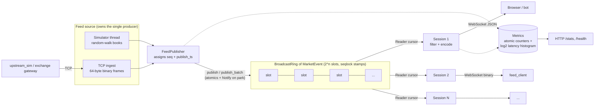

# ferro_feed

A low-latency, real-time market data feed server written in Rust.

ferro_feed takes normalized market events (trades, quotes, order adds and cancels) from a
feed source, publishes them into a **lock-free broadcast ring buffer**, and fans them out to
any number of **WebSocket** subscribers. Each subscriber picks the symbols it wants and either
a JSON or a raw binary wire format.

- **Lock-free hot path.** Publishing and reading are atomics only. The ring has a single
  producer and many consumers, and every slot is guarded by a seqlock-style stamp. The
  producer never waits for readers.
- **No heap allocation per event.** `MarketEvent` is a 64-byte `#[repr(C)]` plain-data struct
  that fits in one cache line. It moves through the ring by copy, and its in-memory bytes are
  the binary wire format, so a binary frame is just `bytemuck::bytes_of(&event)`. Nothing is
  serialized.
- **Slow clients can't stall the feed.** A session that falls more than one ring behind is
  lapped. It gets a `lagged` notice with the number of skipped events and picks up again from
  recent data. Other sessions and the producer aren't affected.
- **Burst batching.** Sessions drain everything already sitting in the ring (up to
  `--max-batch`) and write it with a single flush. Binary mode packs the whole burst into one
  frame.
- **Measurable.** Every event carries its publish timestamp. The server keeps a lock-free
  latency histogram from publish to socket write, served at `/stats`, and `feed_client`
  measures end-to-end latency with HdrHistogram.

## Architecture



### How the ring works

Each slot holds a value and a 64-bit stamp. To write position `p`, the producer sets the
stamp to `2p+1` (write in progress), copies the value in, sets the stamp to `2p+2` (ready),
and advances `head`. To read position `p`, a reader loads the stamp, copies the value out,
then checks the stamp again:

| stamp seen        | meaning                         | result          |
|-------------------|---------------------------------|-----------------|
| `< 2p+2`          | not written yet                 | `Empty` (or `Closed`) |
| `== 2p+2`, stable | value is complete               | `Ok(value)`     |
| `> 2p+2` or changed during the copy | producer lapped the reader | `Lagged(n)`, cursor jumps to half a ring behind `head` |

When there's nothing new, async readers spin briefly and then park on a `tokio::sync::Notify`.
The producer pays for a wake-up only when at least one reader is parked, and it checks with a
Dekker-style `SeqCst` fence pairing so a wake-up can't be lost.

### Source layout

| Path | Purpose |
|------|---------|
| `src/ring.rs` | Lock-free SPMC broadcast ring (`channel`, `Producer`, `Subscriber`, `Reader`) |
| `src/model.rs` | `MarketEvent` (64-byte POD), `Symbol`, `EventKind`, `Side`, fixed-point prices |
| `src/codec.rs` | Zero-copy binary and JSON encodings |
| `src/feed/` | `FeedPublisher`, market simulator, TCP ingest |
| `src/protocol.rs` | WebSocket control messages |
| `src/subscription.rs` | Per-session symbol filter |
| `src/session.rs`, `src/server.rs` | Per-client session task, accept loop |
| `src/metrics.rs`, `src/stats.rs` | Counters, latency histogram, HTTP stats endpoint |
| `src/config.rs`, `src/main.rs` | CLI/env config, wiring, graceful shutdown |
| `src/bin/feed_client.rs` | Latency/throughput measuring client |
| `src/bin/upstream_sim.rs` | Streams simulated binary events into the ingest port |
| `benches/ring.rs` | Criterion benchmarks |
| `tests/` | Async ring concurrency tests, WebSocket and ingest end-to-end tests |

## WebSocket protocol

Connect to `ws://HOST:9000`. The server sends a welcome message:

```json
{"type":"welcome","session":1,"format":"json","symbols":["AAPL","MSFT"],"event_size":64}
```

Client requests are JSON text frames:

```json
{"op":"subscribe","symbols":["AAPL","BTC-USD"]}
{"op":"subscribe","symbols":["*"]}
{"op":"unsubscribe","symbols":["AAPL"]}
{"op":"format","format":"binary"}
{"op":"ping","id":7}
```

The server replies with `subscribed`, `unsubscribed`, `format`, `pong` or `error`. It sends
`{"type":"lagged","skipped":N}` when the session was lapped.

**JSON events** (one per text frame). Prices are decimal strings, so there's no float rounding:

```json
{"type":"trade","seq":1042,"symbol":"AAPL","side":"buy","price":"189.42","qty":100,
 "exchange_ts_ns":1760000000000000000,"publish_ts_ns":1760000000000012000}
```

**Binary events.** Each binary frame holds one or more back-to-back 64-byte little-endian
records:

| offset | type | field |
|-------:|------|-------|
| 0  | u64 | seq |
| 8  | u64 | publish_ts_ns |
| 16 | u64 | exchange_ts_ns |
| 24 | [u8; 8] | symbol (ASCII, NUL-padded) |
| 32 | i64 | price × 10⁸ |
| 40 | u64 | qty |
| 48 | u64 | order_id |
| 56 | u8  | kind (1 trade, 2 quote, 3 order_add, 4 order_cancel, 5 heartbeat) |
| 57 | u8  | side (0 none, 1 buy, 2 sell) |
| 58 | [u8; 6] | reserved |

The TCP ingest port takes the same 64-byte records, streamed back to back. The server
overwrites `seq` and `publish_ts_ns`.

## Running

Requirements: a stable Rust toolchain (1.75+). You don't need any external services,
credentials or special hardware.

```bash
# Server with the built-in simulator (100k events/s across 8 symbols)
cargo run --release

# In another terminal: measure latency/throughput for 10 s over binary frames
cargo run --release --bin feed_client -- --format binary --symbols '*' --duration 10

# Watch a single symbol as JSON
cargo run --release --bin feed_client -- --format json --symbols AAPL --print

# Server metrics
curl -s localhost:9001/stats
```

Using an upstream over TCP instead of the simulator:

```bash
cargo run --release -- --source ingest --ingest-addr 127.0.0.1:9100
cargo run --release --bin upstream_sim -- --addr 127.0.0.1:9100 --rate 200000
```

You can also use any WebSocket client:

```bash
websocat ws://127.0.0.1:9000
{"op":"subscribe","symbols":["BTC-USD"]}
```

### Configuration

You can set every option as a flag or as an environment variable. See `.env.example` and
`cargo run -- --help`.

| Flag | Env | Default |
|------|-----|---------|
| `--ws-addr` | `FERRO_WS_ADDR` | `0.0.0.0:9000` |
| `--stats-addr` | `FERRO_STATS_ADDR` | `127.0.0.1:9001` |
| `--source` | `FERRO_SOURCE` | `sim` (`sim` or `ingest`) |
| `--ingest-addr` | `FERRO_INGEST_ADDR` | `127.0.0.1:9100` |
| `--symbols` | `FERRO_SYMBOLS` | `AAPL,MSFT,NVDA,AMZN,GOOG,BTC-USD,ETH-USD,SOL-USD` |
| `--sim-rate` | `FERRO_SIM_RATE` | `100000` events/s (0 = unthrottled) |
| `--sim-batch` | `FERRO_SIM_BATCH` | `32` |
| `--sim-seed` | `FERRO_SIM_SEED` | random |
| `--ring-capacity` | `FERRO_RING_CAPACITY` | `65536` (power of two) |
| `--max-batch` | `FERRO_MAX_BATCH` | `256` events per session write |
| `--max-sessions` | `FERRO_MAX_SESSIONS` | `10000` |
| `--default-format` | `FERRO_DEFAULT_FORMAT` | `json` |
| `--workers` | `FERRO_WORKERS` | number of cores |

`--ring-capacity` sets how far a session can fall behind before it's lapped. At 100k events/s,
65,536 slots is about 650 ms of headroom, using 4 MiB of memory (64 B per slot).

## Testing

```bash
cargo test                 # unit + integration tests
cargo test --release       # the ring stress tests are faster in release mode
cargo bench                # criterion: publish cost, fan-out to 1/4/8 readers, codec cost
```

What the tests cover:

- **`src/ring.rs` unit tests.** Ordering, wrap-around, fan-out to multiple readers, lag
  detection and resync, close semantics, replay from the oldest slot. A multi-threaded stress
  test checks that readers never see a torn or reordered value.
- **`tests/ring_concurrency.rs`.** 8 async readers on a multi-threaded runtime each receive
  the full ordered stream. A stalled reader is lapped without blocking the producer. A `recv`
  that loses a `select!` doesn't drop a value.
- **`tests/ws_end_to_end.rs`.** A real server and client over loopback. Covers symbol
  filtering, the JSON and binary formats, ping/pong, error replies, metrics counters, and TCP
  ingest, including frames split across reads and rejection of malformed frames.
- **Unit tests** in `model`, `codec`, `protocol`, `subscription`, `metrics`, `config` and
  `feed`.

## Notes and limits

- Latency figures depend on wall-clock timestamps from both sides. Run `feed_client` on the
  same host as the server, or on hosts with PTP-synchronized clocks.
- The binary format assumes a little-endian target. The crate won't compile anywhere else.
- Only one ingest upstream can be connected at a time, because the ring has a single producer.
